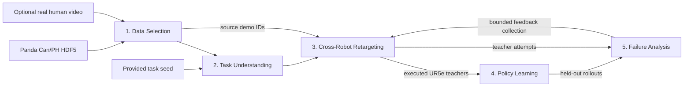

# Cross-Robot Real2Sim

Five-stage research MVP for **can pick → lift → transport → place**, using **Franka Panda** source demonstrations and a learned **UR5e** target policy in robosuite/MuJoCo `PickPlaceCan`.

**Start here:** [English technical report (PDF)](reports/english_technical_report_20261106/Cross_Robot_Real2Sim_Technical_Report.pdf) · [English case studies and videos](results/english_case_studies_20261106/README.md).

The current baseline executes real simulator trajectories and trains on successful target demonstrations. It uses **privileged simulator poses, goals, and grasp contact** (`oracle_sim_state`), source-derived grasp/lift summaries, and hand-coded manipulation phases. Real human-video task extraction and physical-robot transfer remain unverified.

## English video showcase

Each case distinguishes **A: an actual source HDF5 state replay** from **B: a learned UR5e policy rollout**. The source replay renders recorded Panda joint/object states; it is not the separate scripted Panda controller video. All three B panels use the **same frozen fast checkpoint**, trained on **10 UR5e teachers derived from five Panda demos** (`demo_3`, `demo_5`, `demo_7`, `demo_4`, `demo_1`). A displayed source demo is part of the training lineage, not a claim that B was trained solely on that demo.

| Case | Recorded Panda source | English video |
|---|---|---|
| 1 | `demo_3` | [Source replay → learned UR5e](results/english_case_studies_20261106/videos/case_01_demo_3_to_ur5e.mp4) |
| 2 | `demo_5` | [Source replay → learned UR5e](results/english_case_studies_20261106/videos/case_02_demo_5_to_ur5e.mp4) |
| 3 | `demo_7` | [Source replay → learned UR5e](results/english_case_studies_20261106/videos/case_03_demo_7_to_ur5e.mp4) |

The [case-study index](results/english_case_studies_20261106/README.md) records episode seeds, checkpoint and source provenance, evidence checks, and limitations. Older [2026-11-05 review materials](results/review_20261105/README.md), including Korean annotations, remain a historical record; the English report and cases above are the current showcase.

## Five stage folders

The five requested top-level folders are executable navigation entries. Each contains `run.py`, `README.md`, `METHODS.md`, and `ARTIFACTS.md`. The canonical algorithms remain in `src/cross_robot_real2sim/` so installed imports, raw-run provenance, and existing tooling keep working. No algorithm code is duplicated behind these entries.

| Stage folder | Responsibility | Canonical implementation |
|---|---|---|
| [1_Data Selection](<1_Data Selection/>) | Select consistent source demos; optionally rank real human clips | [stage1_selection](src/cross_robot_real2sim/stage1_selection/) |
| [2_Task Understanding](<2_Task Understanding/>) | Validate provided or video-derived task semantics and unknowns | [stage2_task](src/cross_robot_real2sim/stage2_task/) |
| [3_Cross-Robot-Retargeting](3_Cross-Robot-Retargeting/) | Extract source grasp/lift geometry and execute target teachers | [stage3_retarget](src/cross_robot_real2sim/stage3_retarget/) |
| [4_Policy Learning](<4_Policy Learning/>) | Train successful-teacher BC and evaluate a saved policy | [stage4_policy](src/cross_robot_real2sim/stage4_policy/) |
| [5_Failure Analysis](<5_Failure Analysis/>) | Diagnose actual failures and test one bounded corrective iteration | [stage5_diagnosis](src/cross_robot_real2sim/stage5_diagnosis/) |



Shared code lives in [adapters](src/cross_robot_real2sim/adapters/), [contracts](src/cross_robot_real2sim/schemas.py), [orchestrator](src/cross_robot_real2sim/orchestrator/), and [visualization](src/cross_robot_real2sim/viz/). [Configs](configs/) bound compute; [scripts](scripts/) manage durable execution; [tests](tests/) check contracts and runtime; [results](results/README.md) retain published evidence; [reports](reports/) contain the technical PDF. Raw datasets, arrays, checkpoints, and run logs remain local and gitignored.

## Run and monitor over SSH

Tested host: Python 3.10.12, one RTX 4090, robosuite 1.5.2, MuJoCo 3.3.7, PyTorch 2.6.0+cu124, and EGL. Exact installed packages are recorded in [requirements-working-bootstrap.lock](requirements-working-bootstrap.lock). Setup uses an isolated environment without `sudo` or shell-profile changes.

```bash
cd /home/dheo/Cross_Robot_Real2Sim
bash scripts/setup.sh
bash scripts/preflight.sh
bash scripts/launch.sh bootstrap
# Larger bounded baseline:
# bash scripts/launch.sh fast
```

Launch prints the run ID, tmux session, and log path. After launch returns successfully, the pipeline survives SSH/VS Code disconnection while the host stays running; tmux does not provide reboot recovery. GPU 0 is locked against concurrent project runs, and the detached process activates its own environment.

```bash
bash scripts/status.sh                  # latest tracked run
bash scripts/status.sh RUN_ID
tail -f runs/RUN_ID/logs/pipeline.log
bash scripts/resume.sh bootstrap RUN_ID  # use fast/full for that run's profile
bash scripts/stop.sh RUN_ID
```

Resume keeps the run ID/configuration/seeds, validates input/source-code fingerprints and artifact integrity, and reruns invalid stages. Fresh passes preserve prior evidence under stage `history/` directories. Stop targets only the tracked project process group; persisted exit codes distinguish completion from disappearance.

For a single stage, use its wrapper with the same profile and existing upstream artifacts:

```bash
.venv/bin/python "3_Cross-Robot-Retargeting/run.py" --help
.venv/bin/python "3_Cross-Robot-Retargeting/run.py" --config configs/fast.yaml --run-id RUN_ID
```

The wrapper runs one stage in the foreground. Use the detached integrated launch command for long jobs over SSH.

## Inputs, profiles, and honest boundaries

Setup downloads only [robomimic Can / PH / v1.5 low-dimensional HDF5](https://huggingface.co/datasets/robomimic/robomimic_datasets/tree/main/v1.5/can/ph): 46,889,752 bytes and 200 episodes. These are human-operated **Panda robot demonstrations**, distinct from videos of a human performing the task directly.

| Profile | Current path and budget |
|---|---|
| [bootstrap](configs/bootstrap.yaml) | Provided task seed; goal of 3 successful teachers, at most 20 target attempts, 300 BC steps, 3 held-out seeds |
| [fast](configs/fast.yaml) | Five source demos selected from eight candidates; goal of 10 teachers, at most 30 attempts, 2,000 BC steps, 10 held-out seeds |
| [full](configs/full.yaml) | Actual human clips → CLIP ranking → Qwen task JSON, followed by bounded target learning/evaluation |

To exercise real human input later:

```bash
cp /path/to/real_human_can_clip.mp4 data/human/
bash scripts/setup.sh full
bash scripts/launch.sh full
```

Full-mode code uses `openai/clip-vit-base-patch32` and `Qwen/Qwen2.5-VL-3B-Instruct` sequentially on a small ordered frame set, retaining scores and raw/parsed goals. No real clip was supplied for the recorded experiments, so this inference path remains **untested**. Missing full-mode input produces `requires_human_video`; bootstrap/fast explicitly use [the provided task seed](data/task_seeds/can_to_bin.json). Optional SAM2 segmentation is not implemented.

Retargeting transfers **grasp-offset and lift-clearance summaries**, then follows hand-authored target phases with simulator feedback and explicit grip-site calibration. It does not transfer the full source trajectory, source joint angles, or a pretrained source policy. Source orientation is stored for inspection while target OSC holds its initial grip orientation. Separate `source_scripted`, `source_retargeted`, `target_scripted_bootstrap`, and `learned_policy` labels preserve these distinctions.

BC uses a two-hidden-layer 128-unit MLP, XYZ MSE plus gripper BCE, and training-only normalization. Its shared **26D** online feature builder includes privileged object/goal/contact state and event-based phase indicators. The **4D** learned task-space action passes through the same adapter as teacher data into the actual **7D** `BASIC/OSC_POSE` action; one normalized XYZ unit is 0.05 m per control step on the tested stack. This is a state-based simulation baseline with controller structure, not an end-to-end vision policy.

## Measured results

| Actual experiment | Teacher placements | Learned policy before → after feedback |
|---|---:|---:|
| [Bootstrap](results/bootstrap_20261105T181834Z/FINAL_REPORT.md) | 3/3 source-retargeted UR5e teachers | 0/3 → 1/3, after 2 additional teachers |
| [Fast](results/fast_20261105T182127Z/FINAL_REPORT.md) | 10/10 source-retargeted UR5e teachers | 9/10 → 9/10, after 3 additional teachers |

Before/after evaluation uses identical held-out seeds within each experiment. Fast mean final XY placement error changed from **0.0815 m to 0.0846 m**, so no fast improvement is claimed. Small sample counts do not establish statistical generalization, source-summary necessity, visual transfer, or physical-robot performance. Frozen case videos are episode evidence from the shared model, not additional independently trained models.

The main next experiments are source-summary ablations, broader independent seed evaluation, coverage-focused teacher collection, and real human-video goal validation. The legacy diagnostic `unreachable_waypoint` means a waypoint was not reached before timeout; it does not prove kinematic infeasibility.

## Verification and deeper evidence

```bash
source .venv/bin/activate
export CUDA_VISIBLE_DEVICES=0 MUJOCO_GL=egl PYOPENGL_PLATFORM=egl
python -m cross_robot_real2sim.cli check
python -m pytest -q
python -m cross_robot_real2sim.cli report --run-id RUN_ID
```

Tests cover schemas, source layout, action dimensions/clipping, frame/goal logic, deterministic resets, disjoint seeds, successful-teacher filtering, saved-policy loading, stale-output preservation, missing-human behavior, artifact integrity, detached process lifecycle, and five-stage wrapper routing. Simulator tests are marked `sim`; integration/process tests are marked `integration`.

Use the [English PDF](reports/english_technical_report_20261106/Cross_Robot_Real2Sim_Technical_Report.pdf), [English case index](results/english_case_studies_20261106/README.md), [experiment archive](results/README.md), and each stage's `METHODS.md`/`ARTIFACTS.md` for algorithms, provenance, failure evidence, configuration, tests, and remaining limitations.
