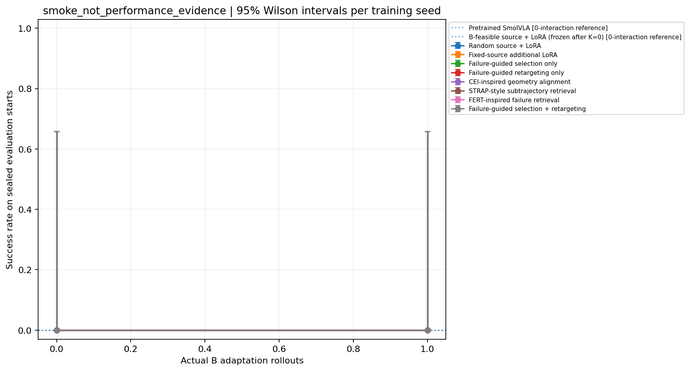

# Fixed-GR1 cross-embodiment adaptation benchmark: measured results

Profile: **smoke_not_performance_evidence**. These are measured runs, not assumed performance. Training seeds: [0]. Requested budgets: [0, 1]. Evaluation starts requested per checkpoint: 2.

All adaptation checkpoints are frozen before final evaluation. No final-evaluation observation, success, error or seed-specific result is supplied to source selection, retargeting, training, checkpoint selection or tuning. Development rollout budget is0; checkpoints are the last weights after a fixed training schedule. Primary success requires the native On predicate for20 consecutive20Hz control steps, matching the earlier protocol; final-step native predicate is also logged.

State banks use distinct native LIBERO initial placements, not repetitions of the two old scenes. The plate placement range is narrow (2cm by2cm), so this is in-distribution evaluation, not broad OOD or physical-robot generalization.

Actual physical interaction counts: {'adaptation': 8, 'development': 0, 'evaluation': 24, 'smoke': 0, 'started_but_no_finished': 0}. Cached results of identical checkpoints are references to the same trials, not additional episodes. Static IK/rendering contributes0 B rollouts.

## Measured checkpoints

| Method | Seed | Allowed K | Actual K | Evaluation n | Success | 95% CI | Mean XY error | Updates | Anchors |
|---|---:|---:|---:|---:|---:|---|---:|---:|---:|
| Pretrained SmolVLA | 0 | 0 | 0 | 2 | 0/2 | [0.000,0.658] | 24.81cm | 0 | 0 |
| Pretrained SmolVLA | 0 | 1 | 0 | 2 | 0/2 | [0.000,0.658] | 24.81cm | 0 | 0 |
| Random source + LoRA | 0 | 0 | 0 | 2 | 0/2 | [0.000,0.658] | 24.81cm | 2 | 81 |
| Random source + LoRA | 0 | 1 | 1 | 2 | 0/2 | [0.000,0.658] | 24.81cm | 4 | 81 |
| B-feasible source + LoRA (frozen after K=0) | 0 | 0 | 0 | 2 | 0/2 | [0.000,0.658] | 24.81cm | 2 | 45 |
| B-feasible source + LoRA (frozen after K=0) | 0 | 1 | 0 | 2 | 0/2 | [0.000,0.658] | 24.81cm | 2 | 45 |
| Fixed-source additional LoRA | 0 | 0 | 0 | 2 | 0/2 | [0.000,0.658] | 24.81cm | 2 | 45 |
| Fixed-source additional LoRA | 0 | 1 | 1 | 2 | 0/2 | [0.000,0.658] | 24.81cm | 4 | 45 |
| Failure-guided selection only | 0 | 0 | 0 | 2 | 0/2 | [0.000,0.658] | 24.81cm | 2 | 45 |
| Failure-guided selection only | 0 | 1 | 1 | 2 | 0/2 | [0.000,0.658] | 24.81cm | 4 | 45 |
| Failure-guided retargeting only | 0 | 0 | 0 | 2 | 0/2 | [0.000,0.658] | 24.81cm | 2 | 45 |
| Failure-guided retargeting only | 0 | 1 | 1 | 2 | 0/2 | [0.000,0.658] | 24.81cm | 4 | 90 |
| CEI-inspired geometry alignment | 0 | 0 | 0 | 2 | 0/2 | [0.000,0.658] | 24.81cm | 2 | 51 |
| CEI-inspired geometry alignment | 0 | 1 | 1 | 2 | 0/2 | [0.000,0.658] | 24.81cm | 4 | 51 |
| STRAP-style subtrajectory retrieval | 0 | 0 | 0 | 2 | 0/2 | [0.000,0.658] | 24.81cm | 2 | 123 |
| STRAP-style subtrajectory retrieval | 0 | 1 | 1 | 2 | 0/2 | [0.000,0.658] | 24.81cm | 4 | 164 |
| FERT-inspired failure retrieval | 0 | 0 | 0 | 2 | 0/2 | [0.000,0.658] | 24.81cm | 2 | 45 |
| FERT-inspired failure retrieval | 0 | 1 | 1 | 2 | 0/2 | [0.000,0.658] | 24.81cm | 4 | 84 |
| Failure-guided selection + retargeting | 0 | 0 | 0 | 2 | 0/2 | [0.000,0.658] | 24.81cm | 2 | 45 |
| Failure-guided selection + retargeting | 0 | 1 | 1 | 2 | 0/2 | [0.000,0.658] | 24.81cm | 4 | 76 |

## What is not established

The hypothesis that failure-guided adaptation beats existing methods is not assumed. A smoke profile has short horizons/tiny evaluation samples and is only an execution check. An incomplete method/budget/seed matrix cannot establish the final research claim. Wilson intervals describe binomial uncertainty within one training seed, not variation across independently trained policies.

CEI-inspired, STRAP-style and FERT-inspired are common-interface adaptations, not official paper reproductions. See the benchmark README for preserved mechanisms and replacements. Source-conditioned synthetic actions do not verify target pushing dynamics. No failed B actions become labels; no hidden B teacher collection is performed.

CUDA-event elapsed timing is a device timeline proxy, not exact GPU-active compute. Peak Torch allocation excludes some EGL/driver allocations. Shared source inspection/embedding preparation, actual cache savings and uncached-equivalent training costs must be read separately.

[CSV](metrics.csv) · [JSON](metrics.json) · [Interaction ledger](rollouts.jsonl) · [Counts](interaction_counts.json)

## Exported videos

- [b_feasible_lora_seed0_K1_episode_0000.mp4](videos/b_feasible_lora_seed0_K1_episode_0000.mp4)
- [cei_inspired_seed0_K1_episode_0000.mp4](videos/cei_inspired_seed0_K1_episode_0000.mp4)
- [fert_inspired_seed0_K1_episode_0000.mp4](videos/fert_inspired_seed0_K1_episode_0000.mp4)
- [fixed_source_train_seed0_K1_episode_0000.mp4](videos/fixed_source_train_seed0_K1_episode_0000.mp4)
- [our_full_seed0_K1_episode_0000.mp4](videos/our_full_seed0_K1_episode_0000.mp4)
- [pretrained_seed0_K1_episode_0000.mp4](videos/pretrained_seed0_K1_episode_0000.mp4)
- [random_lora_seed0_K1_episode_0000.mp4](videos/random_lora_seed0_K1_episode_0000.mp4)
- [retarget_only_seed0_K1_episode_0000.mp4](videos/retarget_only_seed0_K1_episode_0000.mp4)
- [selection_only_seed0_K1_episode_0000.mp4](videos/selection_only_seed0_K1_episode_0000.mp4)
- [strap_style_seed0_K1_episode_0000.mp4](videos/strap_style_seed0_K1_episode_0000.mp4)
